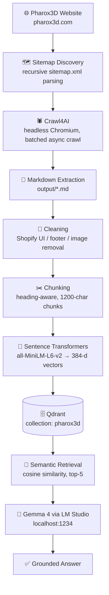
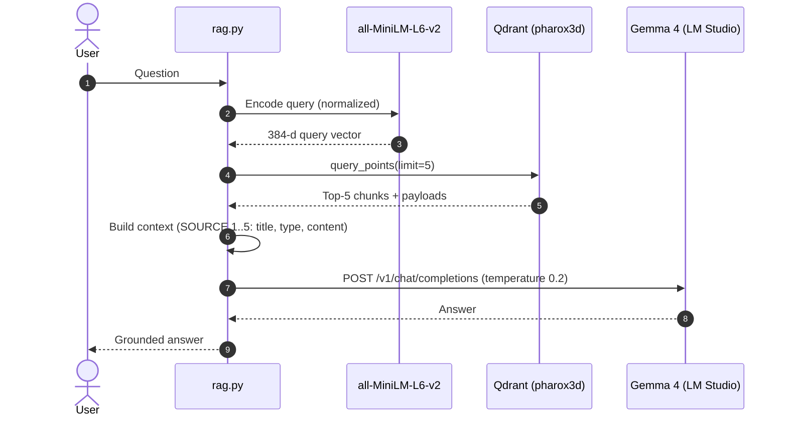
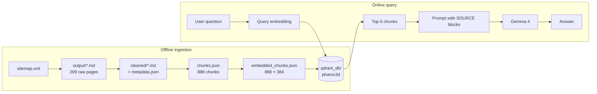

# Pharox3D Website-to-RAG

**Turn a live e-commerce website into a grounded, locally-hosted question-answering assistant.**

This project crawls the [Pharox3D](https://pharox3d.com) storefront (a 3D-printing shop), cleans and chunks every page, embeds the chunks into a **Qdrant** vector database, and answers natural-language questions with a **local Gemma 4 model served by LM Studio** — using only the retrieved website content as context.

No cloud LLM API, no API keys: the whole pipeline, from crawler to LLM, runs on your machine.


---

## 📌 At a glance

Numbers from the current run of the pipeline:

| Stage | Result |
| --- | --- |
| URLs discovered from the sitemap hierarchy | **209** |
| Pages crawled to Markdown | **209** (187 products, 17 collections, pages, blog, `agents.md`) |
| Cleaned documents | **209** + `metadata.json` |
| Chunks produced | **888** |
| Embedding model | `sentence-transformers/all-MiniLM-L6-v2` |
| Embedding dimensions | **384** (L2-normalized) |
| Vector store | Qdrant (local, on-disk), collection **`pharox3d`**, cosine distance, **888 points** |
| Generator | `google/gemma-4-e4b` via LM Studio's OpenAI-compatible API |
| Retrieval depth | Top-**5** chunks per question |

---

## 🏗️ Architecture



The pipeline is split into small, single-purpose scripts. Each stage reads the previous stage's output from disk, so any step can be re-run or inspected independently.

| # | Script | Input | Output |
| --- | --- | --- | --- |
| 1 | `crawler_fast.py` | `https://pharox3d.com/sitemap.xml` | `output/NNNN_<path>.md` |
| 2 | `cleaner.py` | `output/*.md` | `cleaned/*.md`, `cleaned/metadata.json` |
| 3 | `chunker.py` | `cleaned/*.md` | `chunks/chunks.json` |
| 4 | `embedder.py` | `chunks/chunks.json` | `chunks/embedded_chunks.json` |
| 5 | `vector_db.py` | `chunks/embedded_chunks.json` | `qdrant_db/` (collection `pharox3d`) |
| 6 | `retrieve.py` | question | top-5 chunks with scores |
| 7 | `rag.py` | question | grounded answer from Gemma 4 |

---

## ⚙️ How it works

### 1. Sitemap discovery

`crawler_fast.py` downloads `https://pharox3d.com/sitemap.xml` and walks it **recursively**: if the document is a sitemap index (`<sitemap><loc>`), each child sitemap (products, collections, pages, blogs, …) is fetched and parsed; if it is a URL set (`<url><loc>`), the page URLs are collected. URLs are then filtered to the `https://pharox3d.com/` domain and de-duplicated while preserving order.

### 2. Crawling with Crawl4AI

URLs are crawled with a single shared `AsyncWebCrawler` (headless Chromium, `CacheMode.BYPASS`) in **batches of 10 concurrent requests** via `asyncio.gather`. Each successful result's Markdown is written to `output/` with a stable, index-prefixed filename derived from the URL path (e.g. `0002_products_custom-name-keychain.md`). A small `psutil`-based monitor logs current and peak memory per batch, and a summary of successes/failures is printed at the end.

### 3. Cleaning

Raw Crawl4AI Markdown from a Shopify store is full of storefront chrome. `cleaner.py`:

- **Classifies** each document from its filename: `product`, `collection`, `page`, `blog`, `policy`, `agent_infrastructure`, or `other`.
- **Un-escapes** Markdown (`\#`, `\*`, `\(` …) and turns bold-wrapped headings (`**# Title**`) into real headings.
- **Strips** navigation/cart/share UI ("Add to cart", "Buy it now", "View cart", quantity controls, …), image and asset lines, and everything from the Shopify **footer** onward.
- For **product pages**, keeps content only from the first H1 onward, discarding header navigation.
- **Removes link URLs** while keeping the visible link text, drops consecutive duplicate lines, and collapses excess blank lines.
- Extracts a **title** (first H1, falling back to the filename) and writes `metadata.json` with `filename`, `title`, `type`, and `text` for every document.

> The navigation and footer term lists are intentionally conservative — generic phrases like "your name" are *not* filtered, because they appear as legitimate product customization fields.

### 4. Chunking

`chunker.py` produces structure-aware chunks:

1. Split each document at **H1/H2/H3 headings**, so a chunk never straddles two sections.
2. Sections ≤ **1200 characters** become a single chunk.
3. Larger sections are packed **paragraph by paragraph** up to 1200 characters; a single oversized paragraph falls back to a sliding window with **200-character overlap**.

Each chunk carries metadata — `text`, `title`, `type`, `source`, `filename`, and a global `chunk_id`.

| Document type | Documents | Chunks |
| --- | ---: | ---: |
| product | 187 | 527 |
| collection | 17 | 310 |
| other / page / blog / agent_infrastructure | 5 | 51 |
| **Total** | **209** | **888** |

### 5. Embedding

`embedder.py` encodes every chunk with **`sentence-transformers/all-MiniLM-L6-v2`** (batch size 32, `normalize_embeddings=True`), producing **384-dimensional unit vectors** stored alongside the chunk metadata.

### 6. Vector storage

`vector_db.py` starts Qdrant in **embedded local mode** (`QdrantClient(path="qdrant_db")`, no server required), (re)creates the `pharox3d` collection with `size=384` and **cosine** distance, and upserts one point per chunk — the point ID is the `chunk_id`, and the full chunk metadata is stored as the payload.

### 7. Retrieval & generation



The question is embedded with the **same model** used at indexing time, the five nearest chunks are retrieved, and each is formatted as a numbered `SOURCE` block with its title, type, and content. The prompt instructs the model to:

- act as a Pharox3D customer-support assistant,
- answer **only** from the provided context,
- reply *"I couldn't find that information in the Pharox3D knowledge base."* when the context does not contain the answer, and
- never invent prices, products, features, or policies.

Generation uses a low temperature (`0.2`) for factual, consistent answers.

---

## 🧰 Tech stack

| Layer | Technology |
| --- | --- |
| Language / env | Python 3.13, [uv](https://docs.astral.sh/uv/) |
| Sitemap fetching | `requests` + `xml.etree.ElementTree` |
| Crawling | [Crawl4AI](https://github.com/unclecode/crawl4ai) (Playwright / headless Chromium) |
| Cleaning & chunking | Pure Python (`re`, `pathlib`, `json`) |
| Embeddings | [Sentence Transformers](https://www.sbert.net/) — `all-MiniLM-L6-v2` |
| Vector database | [Qdrant](https://qdrant.tech/) via `qdrant-client` (local mode) |
| LLM | Gemma 4 (`google/gemma-4-e4b`) served by [LM Studio](https://lmstudio.ai/) |
| LLM interface | OpenAI-compatible `/v1/chat/completions` over HTTP |

---

## 📁 Project structure

```text
pharox3d-website-to-rag/
├── src/
│   └── crawl4ai_test/
│       ├── __init__.py        # Package entry point (placeholder)
│       ├── crawler.py         # Single-page Crawl4AI smoke test (homepage)
│       ├── crawler_fast.py    # Sitemap discovery + batched async crawl
│       ├── cleaner.py         # Shopify-aware Markdown cleaning + metadata
│       ├── chunker.py         # Heading-aware chunking
│       ├── embedder.py        # Sentence-Transformers embeddings
│       ├── vector_db.py       # Qdrant collection creation + upsert
│       ├── retrieve.py        # Semantic search CLI (top-5 with scores)
│       └── rag.py             # Retrieval-augmented generation with Gemma 4
├── pyproject.toml
├── uv.lock
├── .python-version
└── README.md

# Generated locally by the pipeline (git-ignored):
├── output/                    # Raw crawled Markdown       (209 files)
├── cleaned/                   # Cleaned Markdown + metadata.json
├── chunks/                    # chunks.json, embedded_chunks.json
└── qdrant_db/                 # Local Qdrant storage
```

---

## 🚀 Installation

**Prerequisites**

- Python **3.13** and [uv](https://docs.astral.sh/uv/getting-started/installation/)
- [LM Studio](https://lmstudio.ai/) with **`google/gemma-4-e4b`** downloaded and the local server running on `http://localhost:1234` (only needed for `rag.py`)

```bash
git clone https://github.com/YoussefIEissa/pharox3d-website-to-rag.git
cd pharox3d-website-to-rag

# Install dependencies from the lockfile
uv sync

# Install the Playwright browser used by Crawl4AI
uv run crawl4ai-setup
```

The first run of `embedder.py` / `retrieve.py` / `rag.py` downloads `all-MiniLM-L6-v2` from Hugging Face.

---

## ▶️ Usage

> All scripts resolve paths relative to the current working directory — **run them from the repository root.**

### Build the knowledge base

```bash
uv run python src/crawl4ai_test/crawler_fast.py   # 1. sitemap → output/*.md
uv run python src/crawl4ai_test/cleaner.py        # 2. output/ → cleaned/
uv run python src/crawl4ai_test/chunker.py        # 3. cleaned/ → chunks/chunks.json
uv run python src/crawl4ai_test/embedder.py       # 4. → chunks/embedded_chunks.json
uv run python src/crawl4ai_test/vector_db.py      # 5. → qdrant_db/ (collection "pharox3d")
```

### Search the knowledge base (retrieval only)

```bash
uv run python src/crawl4ai_test/retrieve.py "How much does the custom name keychain cost?"
```

```text
RESULT 1
Score: 0.6531
Title: Custom Name Keychain (English and Arabic )
Type: product
File: 0002_products_custom-name-keychain.md
--------------------------------------------------------------------------------
...
RESULT 3
Score: 0.5313
Title: Collection: Keychains & Small Accessories
Type: collection
File: 0194_collections_keychains-small-accessories.md
```

### Ask a question (full RAG)

Start the LM Studio server with Gemma 4 loaded, then:

```bash
uv run python src/crawl4ai_test/rag.py "How much does the custom name keychain cost?"
```

---

## 💬 Example queries

Real outputs from `rag.py` against the current index (Gemma 4 E4B, top-5 retrieval):

| Question | Answer |
| --- | --- |
| *How much does the custom name keychain cost?* | The custom name keychain has a Regular price of LE 69.00 EGP, and the Sale price is also LE 69.00 EGP. |
| *How much does the jar opener cost?* | The regular price and sale price for the EasyGrip Jar Opener are LE 69.00 EGP. |
| *I want a personalized keychain with my name* | You can personalize a keychain with your name using the Custom Name Keychain (English and Arabic) product. … |
| *What is the capital of France?* | I couldn't find that information in the Pharox3D knowledge base. |

The last question is deliberately **out of domain**. Gemma certainly *knows* the answer, but because nothing about it exists in the retrieved Pharox3D context, the system follows its grounding instruction and declines instead of answering from the model's general knowledge. This is the behavior you want from a store assistant: it stays inside the knowledge base rather than improvising.

### Example RAG response

```text
$ uv run python src/crawl4ai_test/rag.py "I want a personalized keychain with my name"

Question: I want a personalized keychain with my name
================================================================================
Loading embedding model...
Retrieving relevant documents...
Retrieved 5 chunks
Generating answer with Gemma...

ANSWER
================================================================================
You can personalize a keychain with your name using the Custom Name Keychain (English and Arabic) product.

To order one:
1. Simply enter your name when placing your order.
2. Pharox3D will then print it on your custom-printed keychain.

These keychains are durable, high-quality, and perfect for keeping your keys organized in style.
```

Note that this query never mentions a product name or a price — semantic retrieval maps the *intent* ("personalized keychain with my name") to the right product page.

---

## 🔄 Data flow



Every chunk keeps the same payload end to end, so any answer can be traced back to its source file:

```json
{
  "text": "## Custom Name Keychain (English and Arabic )\nRegular price LE 69.00 EGP\n...",
  "title": "Custom Name Keychain (English and Arabic )",
  "type": "product",
  "source": "pharox3d.com",
  "filename": "0002_products_custom-name-keychain.md",
  "chunk_id": 45
}
```

---

## 🎯 Retrieval architecture

| Aspect | Choice | Why |
| --- | --- | --- |
| Embedding model | `all-MiniLM-L6-v2` | Small, fast, CPU-friendly; good quality for short product/catalog text |
| Vector normalization | Yes (indexing and query) | Makes cosine similarity equivalent to a dot product and keeps scores comparable |
| Distance | Cosine | Standard for sentence embeddings |
| Index | Qdrant local mode | Persistent on-disk store with no server to run |
| Unit of retrieval | Heading-bounded chunk ≤ 1200 chars | Keeps a product's price, options and description together |
| Top-K | 5 | Enough context for product questions without flooding a small local LLM |
| Context format | `SOURCE i` + title + type + content | Gives the LLM explicit document boundaries and titles |
| Grounding | Strict "context only" prompt + refusal sentence | Prevents hallucinated prices and products |

---

## 🔧 Configuration

Configuration lives as module-level constants at the top of each script:

| Setting | Value | File |
| --- | --- | --- |
| `SITEMAP_URL` | `https://pharox3d.com/sitemap.xml` | `crawler_fast.py` |
| `MAX_CONCURRENT` | `10` | `crawler_fast.py` |
| `CHUNK_SIZE` / `CHUNK_OVERLAP` | `1200` / `200` characters | `chunker.py` |
| `MODEL_NAME` / `EMBEDDING_MODEL` | `sentence-transformers/all-MiniLM-L6-v2` | `embedder.py`, `retrieve.py`, `rag.py` |
| `VECTOR_SIZE` | `384` | `vector_db.py` |
| `QDRANT_PATH` | `qdrant_db` | `vector_db.py`, `retrieve.py`, `rag.py` |
| `COLLECTION_NAME` | `pharox3d` | `vector_db.py`, `retrieve.py`, `rag.py` |
| `LLM_MODEL` | `google/gemma-4-e4b` | `rag.py` |
| `LM_STUDIO_URL` | `http://localhost:1234/v1/chat/completions` | `rag.py` |
| `TOP_K` | `5` | `rag.py` |

Because LM Studio exposes an OpenAI-compatible endpoint, swapping in a different local model only requires changing `LLM_MODEL`.

---

## 🛣️ Future improvements

- **Single CLI / orchestration** — one command (`build`, `ask`) instead of five scripts, with shared config in one place (or `.env`).
- **Shared utilities** — `get_document_type` / `extract_title` are currently duplicated between `cleaner.py` and `chunker.py`.
- **Hybrid search** — add BM25 / sparse vectors in Qdrant so exact product names and SKUs score higher.
- **Re-ranking** — a cross-encoder over the top-K to improve precision before generation.
- **Metadata filtering** — use the stored `type` payload (e.g. prefer `product` over `collection` for price questions).
- **Source citations** — return the source titles/URLs alongside each answer.
- **Evaluation** — a labeled question set to measure retrieval hit-rate and answer faithfulness.
- **Incremental updates** — re-crawl only URLs whose sitemap `lastmod` changed, instead of rebuilding the collection.
- **Interfaces** — a chat UI (Streamlit / Gradio) or a FastAPI endpoint, plus streaming responses.
- **Tests** — unit tests for the cleaning and chunking rules.

---

## 👤 Author

**Youssef Ibrahim** — AI Engineering

GitHub: [@YoussefIEissa](https://github.com/YoussefIEissa)
